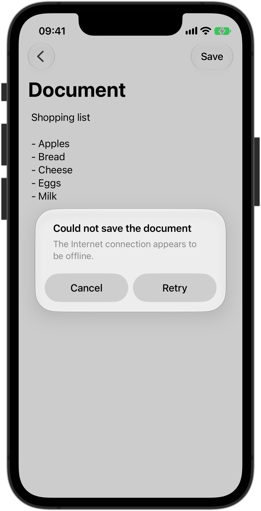
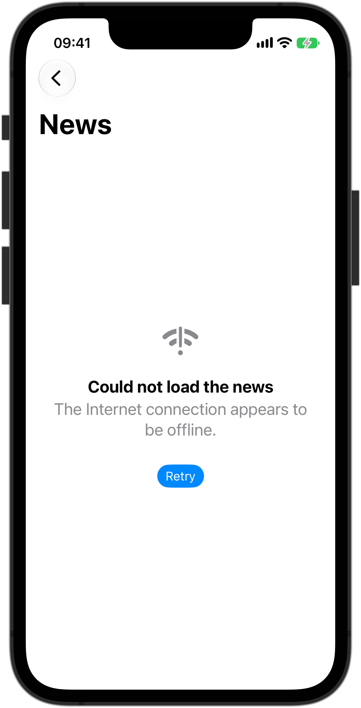

# FlowErrorKit

**Error handling for SwiftUI apps**

**Requirements**: iOS 18.0+ / macOS 15.0+ / tvOS 18.0+ / visionOS 2.0+ / watchOS 11.0+ &bull; Swift 6.4+

📖 **[Documentation]**

---

This package helps SwiftUI applications catch errors, present them to the user, and respond to the user's choice (cancel, retry, or any other action).

Generally speaking, views catch errors and present them with an alert or another technique. Error handlers, registered in the SwiftUI environment, decide how specific errors are presented, and can perform side effects such as signing the user out, requesting an app update, or letting the user open the Settings application. Built-in handlers take care of `CancellationError`, `CocoaError`, and `URLError`, and you can add your own for the errors specific to your app.

## Usage

Catch the error, turn it into a `FlowError`, and present it with an alert:

<picture>
  <source media="(prefers-color-scheme: dark)" srcset="Documentation/Images/Alert-dark.png">
  
</picture>

```swift
import FlowErrorKit
import SwiftUI

struct DocumentView: View {
    @State private var flowError: FlowError?

    var body: some View {
        DocumentEditor()
            .toolbar {
                Button("Save") {
                    save()
                }
            }
            .presentError($flowError, with: .alert)
    }

    func save() {
        do {
            try saveDocument()
        } catch {
            flowError = FlowError(error: error)
                .withTitle("Could not save the document")
                .onRetry { save() }
        }
    }
}
```

<br clear="right">

Or display the error in place of the view content, with an `ErrorPresentationView`:

<picture>
  <source media="(prefers-color-scheme: dark)" srcset="Documentation/Images/ErrorPresentationView-dark.png">
  
</picture>

```swift
import FlowErrorKit
import SwiftUI

struct NewsView: View {
    @State private var news: [Article] = []
    @State private var flowError: FlowError?

    var body: some View {
        List(news) { article in
            Text(article.title)
        }
        .presentError($flowError, with: .errorPresentationView)
        .task { await load() }
    }

    func load() async {
        do {
            news = try await fetchNews()
            // Success: remove the error presentation
            flowError = nil
        } catch {
            flowError = FlowError(error: error)
                .withTitle("Could not load the news")
                .onRetry { Task { await load() } }
        }
    }
}
```

<br clear="right">

Other presentations, such as a toast, a banner, or a sheet, are possible with a custom `FlowErrorPresenter`:

```swift
// ToastPresenter is a custom FlowErrorPresenter
.presentError($flowError, with: ToastPresenter())
```

For more details, see the [Documentation].

## AI Coding Assistants

FlowErrorKit comes with a skill that helps coding agents write code that uses the library.

In Claude Code:

```
/plugin marketplace add groue/FlowErrorKit
/plugin install flowerrorkit@flowerrorkit
```

In other tools (requires [Node.js](https://nodejs.org)):

```bash
npx skills add groue/FlowErrorKit
```

The skill evolves with the library, and does not update by itself. When you upgrade FlowErrorKit, update the skill as well.

In Claude Code, run `/plugin marketplace update flowerrorkit`, then `/reload-plugins`. To get updates automatically, enable auto-update for the `flowerrorkit` marketplace, in the Marketplaces tab of `/plugin`.

In other tools:

```bash
npx skills update flowerrorkit
```

## Thanks

Thank you [@pakko972](https://github.com/pakko972) for years of shared effort toward an error-handling library that does not suck.

[Documentation]: https://swiftpackageindex.com/groue/FlowErrorKit/documentation
